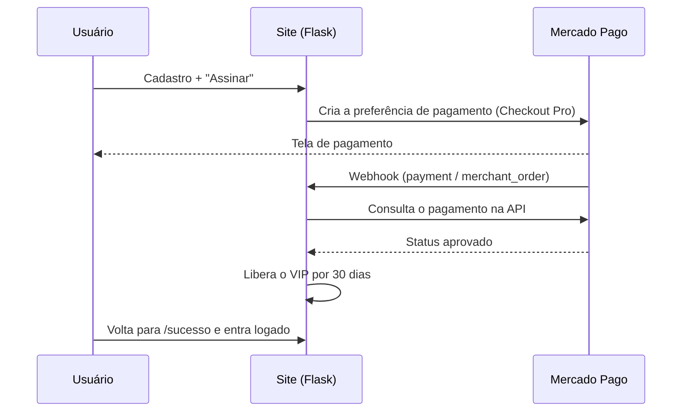

<div align="center">



    

<a href="https://github.com/Kauesouzavr/plataforma-de-aposta-tips/actions/workflows/ci.yml"></a> <a href="https://github.com/Kauesouzavr/plataforma-de-aposta-tips/actions/workflows/codeql.yml"></a> <a href="https://github.com/Kauesouzavr/plataforma-de-aposta-tips/actions/workflows/secret-scan.yml"></a>

<a href="https://curso-yvqf.onrender.com"><b>🌐 Ver o site no ar</b></a> · <a href="#segurança"><b>Segurança</b></a> · <a href="TECNOLOGIAS.md"><b>Todas as tecnologias</b></a>

</div>

> 🇺🇸 **In English:** a paid-membership platform built for a real client and running in production. People sign up, pay a monthly fee through Mercado Pago and unlock a members-only area with daily sports analysis and protected videos. Flask + PostgreSQL on Render, with hashed passwords, CSRF protection, rate limiting, a 2-device limit per account with e-mail verification, and payments confirmed through the provider's API (never by the return URL alone).

## O que o site faz

Plataforma de assinatura VIP para análises esportivas, feita para um cliente e **em produção**. A pessoa se cadastra, paga a mensalidade pelo Mercado Pago e ganha acesso a uma área exclusiva com as análises publicadas todo dia por um operador autorizado, além de um vídeo de boas-vindas.

| Quem | O que faz |
| --- | --- |
| **Assinante** | Cadastro, pagamento, área VIP com as análises do dia e os vídeos |
| **Operador** (`/painel`) | Publica e destaca as análises, com login próprio |
| **Administrador** (`/admin`) | Acompanha usuários e pagamentos, com outra senha |

## Como o pagamento funciona



O acesso só é liberado depois que o próprio site **consulta o pagamento na API** do Mercado Pago. Mexer na URL de retorno não libera nada; isso é coberto por teste automatizado.

## Segurança

- **Senhas com hash** (`werkzeug.security`, scrypt) e sessões assinadas com `SECRET_KEY`.
- **Proteção CSRF** em todos os formulários (Flask-WTF) e cookies `HttpOnly`, `Secure` e `SameSite=Lax`.
- **Limite de tentativas** no login, no código de verificação e nos formulários.
- **Até 2 dispositivos por conta**: um aparelho novo precisa de um código de 6 dígitos enviado por e-mail (Brevo).
- **Vídeos protegidos**, servidos por rota autenticada, com marca d'água do e-mail do usuário para rastrear vazamentos.
- **Senhas separadas** para o painel do operador e para o admin.
- **Cabeçalhos de segurança** em todas as respostas (anti-clickjacking, `nosniff`, HSTS).
- **No CI:** testes de segurança (pytest), CodeQL, Gitleaks e Dependabot. Veja também o [`SECURITY.md`](SECURITY.md).

## Stack

| Parte | Escolha |
| --- | --- |
| Backend | Python 3.11 + Flask, Gunicorn em produção |
| Banco | PostgreSQL no Supabase (via Session Pooler) |
| Pagamentos | Mercado Pago Checkout Pro + webhook |
| E-mail | Brevo (API HTTPS) |
| Frontend | HTML, CSS e JavaScript puros com Jinja2; efeitos 3D só com CSS |
| Hospedagem | Render, com deploy automático a cada push na `main` |

A lista completa, com o porquê de cada escolha, está em [`TECNOLOGIAS.md`](TECNOLOGIAS.md).

## Rodar localmente

```bash
python -m venv .venv
source .venv/bin/activate        # no Windows: .venv\Scripts\activate
pip install -r requirements.txt
```

Crie um arquivo `.env` com as variáveis abaixo (só os nomes aparecem aqui; os valores nunca vão para o Git):

```
SECRET_KEY  MP_ACCESS_TOKEN  ADMIN_PASSWORD  PALPITES_PASSWORD
BASE_URL  DATABASE_URL  BREVO_API_KEY  BREVO_SENDER_EMAIL
```

```bash
flask --app app run     # site em http://localhost:5000
python -m pytest        # testes de segurança
```

---

Feito por **Kauê Souza** · [LinkedIn](https://www.linkedin.com/in/kauesouzaproti/) · [GitHub](https://github.com/Kauesouzavr)
